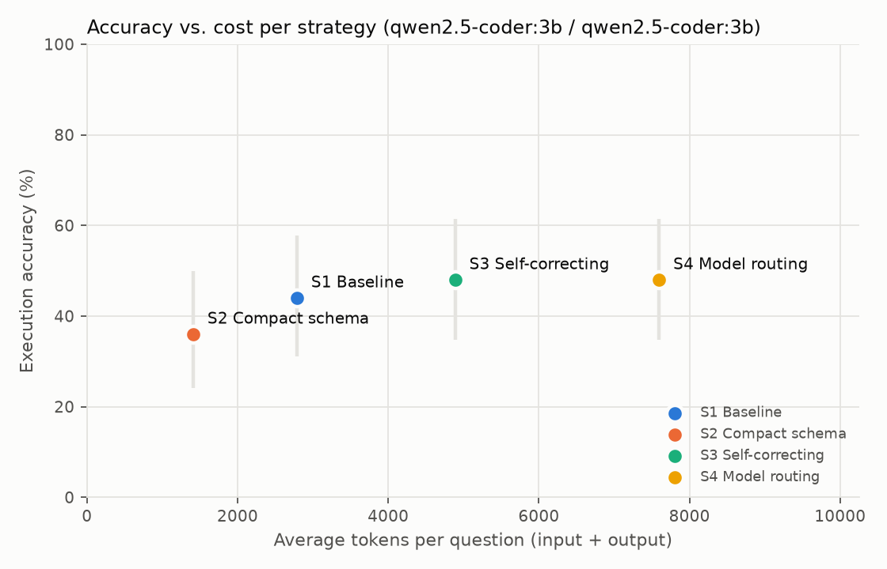
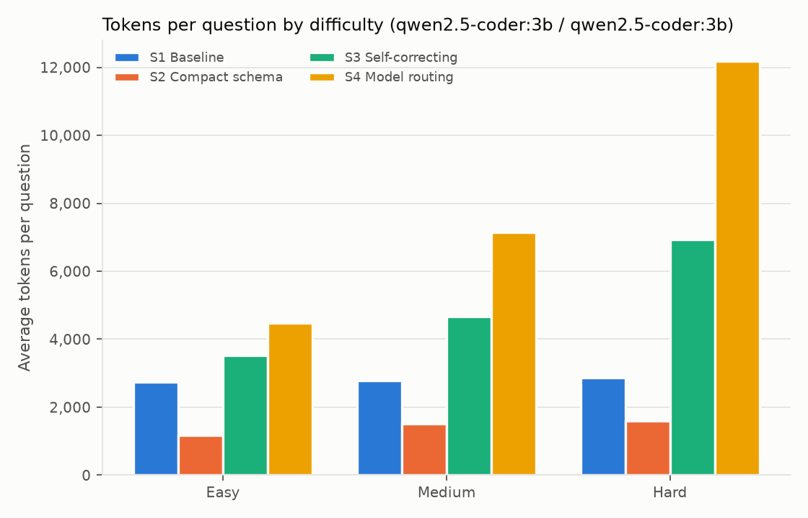

# AgroQuery: Cost-Aware LLM Agents for Agricultural Data Analysis

**How much can we cut the token cost of an LLM data agent without losing accuracy?**

AgroQuery answers natural-language questions over agricultural sensor and weather
data stored in PostgreSQL, and benchmarks four agent strategies on **execution
accuracy, tokens, cost and latency**. It is a small, fully reproducible experiment
rather than a chatbot: a purpose-built database, a 50-question benchmark with gold
SQL, and one command that regenerates every number in this README.

## Motivation

I work as an engineer at a precision-agriculture startup, where field data (soil
sensors, weather, harvest records) is hard for agronomists to query and LLM costs
add up quickly. This project explores cost-efficient agentic data analysis on a
realistic farm database, with three questions in mind:

1. Does sending only the relevant part of the schema save tokens without hurting accuracy?
2. How much accuracy does a self-correction loop buy, and at what token cost?
3. Can routing to a small model first, and escalating only on failure, cut total cost?

## Data

| Table | Rows | Source |
|---|---:|---|
| `regions` | 5 | Five agricultural zones of Colombia |
| `weather_daily` | 5,480 | **Real** daily weather, [Open-Meteo historical API](https://open-meteo.com/en/docs/historical-weather-api), 2023-2025 |
| `crops` | 8 | Reference data: cycle type, optimal soil-moisture range |
| `farms` / `fields` | 40 / 116 | Synthetic |
| `sensors` | 299 | Synthetic: soil moisture, soil temperature, pH |
| `sensor_readings` | 2,954,712 | Synthetic, driven by real hourly weather |
| `alerts` | 4,203 | Derived from readings crossing thresholds |
| `harvests` | 1,012 | Synthetic, yield depends on simulated water stress |

The synthetic part is not random noise. Soil moisture follows an hourly
water-balance model driven by **real** rainfall and reference evapotranspiration
(ET0), with irrigation, drainage, sensor noise and outages. Soil temperature is a
damped, lagged version of real air temperature. Harvest yields depend on the water
stress each field actually went through. As a result, the data has real structure
to discover: monthly rainfall and soil moisture correlate at 0.7-0.8, and irrigated
rice yields about 20% more than rain-fed rice. Because the farm data is generated,
the answers cannot have been memorized from any LLM's training data.

Column semantics live in the database itself (`COMMENT ON`, see
[`db/schema.sql`](db/schema.sql)), so the agent reads the same documentation a new
analyst would.

## Benchmark

[`benchmark/questions.jsonl`](benchmark/questions.jsonl) holds 50 questions with gold
SQL: 18 easy, 18 medium and 14 hard. They cover filters and aggregations,
multi-table joins, top-k, `LEFT JOIN` with zero counts, domain glossary terms
("dry season", "yield"), temporal windows ("rain in the 30 days before harvest"),
gaps-and-islands, window functions and correlations. A readable version with the
expected results is in [`benchmark/questions.md`](benchmark/questions.md).

Every gold query is checked by `agroquery validate`: it must run, return rows, be
deterministic, and have no ties at a `LIMIT` boundary.

**Metric: execution accuracy.** The generated SQL and the gold SQL are both
executed, and their *results* are compared, never the SQL text. Row order matters
only when the question asks for an ordering, column order and names are ignored,
and numbers match within 1% (or 0.01), so rounding an average is not penalized.
See [`agroquery/eval/compare.py`](agroquery/eval/compare.py).

## Strategies

| ID | Strategy | How it works |
|----|----------|--------------|
| S1 | Baseline | Full schema (with comments, categorical values and 3 sample rows per table) in the prompt; one call to the large model |
| S2 | Compact schema | The small model reads a one-line-per-table catalog and picks the tables and columns needed; the large model writes SQL with only those, plus the keys needed for joins |
| S3 | Self-correcting | S1, then execute; on an error or an empty result, retry with that feedback (at most 3 attempts) |
| S4 | Model routing | S3 with the small model; escalate to S3 with the large model only if the small model never produced a query that runs and returns rows |

Models: **Claude Haiku 5.5** (small, $0.10 / $0.50 per million input / output
tokens) and **Claude Sonnet 5.5** (large, $2 / $10). Extended thinking is off, so
strategies are compared on the tokens they need to write SQL. A local model
(`qwen2.5-coder:3b` via [Ollama](https://ollama.com)) runs the same pipeline for
free during development.

For each question and strategy, AgroQuery records correctness, input and output
tokens over every call, cost in USD, LLM latency and SQL latency, the number of
attempts, and whether S4 escalated. Full traces, including every generated query,
are written next to the results.

## Results

> Results will be filled in from the final run.





## Limitations

- **Small benchmark in a single domain.** With 50 questions, the 95% confidence
  intervals on accuracy are roughly ±13 points, so only large differences are
  conclusive.
- **Synthetic farm data.** The weather is real, but the farm, sensor and harvest
  data come from a simple simulation. Real deployments have messier data:
  inconsistent names, units and missing metadata.
- **Small schema.** Nine tables is small compared to production warehouses, so
  schema pruning (S2) has less to save here than it would at scale.
- **The escalation signal is weak by design.** S4 escalates only when a query fails
  or returns nothing; it cannot detect a query that runs and is wrong, because gold
  answers are not available at inference time.
- **Point-in-time results.** Results depend on the specific models and their
  prices at the time of the experiment (November 2026).
- Token counts for the local model are as reported by Ollama.

## Reproduce

Requirements: [Docker](https://www.docker.com/), [uv](https://docs.astral.sh/uv/),
and either an Anthropic API key or [Ollama](https://ollama.com).

```bash
cp .env.example .env            # add ANTHROPIC_API_KEY (optional) and MAX_USD
uv sync
uv run agroquery all            # Postgres -> data -> validate -> eval -> analyze
```

Or step by step:

```bash
uv run agroquery up             # PostgreSQL 16 in Docker (port 5433)
uv run agroquery data           # download weather, generate and load (~1 min)
uv run agroquery validate       # check the 50 gold queries
uv run agroquery eval --provider anthropic --repeat 3
uv run agroquery analyze        # results table + figures
uv run agroquery ask "Which 5 fields had the most low-moisture alerts in the dry season?"
```

The data generator is seeded, so the database is identical on every machine. LLM
responses are cached on disk (`.cache/`), so re-running an evaluation costs nothing.
`MAX_USD` caps the spend of a single run. Model-generated SQL runs as a read-only
database role with a 30-second statement timeout.

## Project layout

```
agroquery/
  data/     fetch_weather.py, generate_farms.py, load.py
  agent/    llm.py, pricing.py, schema.py, sql_exec.py, strategies.py
  eval/     benchmark.py, compare.py, validate.py, run_eval.py, analyze.py
  cli.py
benchmark/  questions.jsonl, questions.md
db/         schema.sql, post_load.sql
results/    one folder per run: results.csv, traces.jsonl, meta.json, summary.md
figures/
tests/
```

## Built with

Python, PostgreSQL, the Anthropic Claude API and Ollama. Developed with
[Claude Code](https://claude.com/claude-code).
